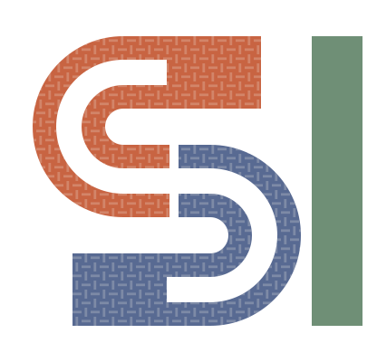

<p align="center">
  <picture>
    <source media="(prefers-color-scheme: dark)" srcset="assets/brand/selvage-symbol-colour-on-dark.svg">
    
  </picture>
</p>

<h1 align="center">Selvage</h1>

<p align="center"><strong>Vibe coding that survives real engineering.</strong></p>

<p align="center">
  Describe what you want. Selvage implements it locally, runs your build and tests,
  routes the change to an independent model for review, and leaves you with a
  reviewed, test-backed branch ready for your approval.
</p>

<p align="center">
  <a href="#before-you-start"><strong>Install Selvage</strong></a> ·
  <a href="#from-request-to-reviewed-branch"><strong>See how it works</strong></a>
</p>

<p align="center"><strong>Local-first · Use your AI subscriptions · Independent review · You decide what ships</strong></p>

---

Selvage is an autonomous code implementation pipeline—not merely a verifier or another chat window. It coordinates the work from request to reviewed branch while keeping the engineering controls you already rely on:

- **It implements the change.** An agent works in an isolated Git worktree instead of editing your checkout.
- **It proves what happened.** Builds, tests, commits, findings, usage, and decisions are captured as evidence.
- **It separates implementation from review.** Reviewer identity is recorded, and same-model self-review is not treated as independent review.
- **It uses your existing AI access.** Bring an authenticated Kiro CLI (Claude Code, Codex and OpenCode adapters are [experimental](#experimental-adapters)). Selvage works through that tool; no separate Selvage model-token package is required.
- **It leaves publication to you.** A human approval gate owns the final decision.

## Before you start

Selvage drives an AI coding CLI that is already installed and signed in on your machine. It runs your project's own build and tests. Set these up first; each step takes a minute or two.

1. **A supported system:** macOS or Linux. Windows is not supported.

2. **Your repository, checked out on a branch:**
   ```bash
   git clone <your repo> && cd <your repo>
   git switch main          # a branch, not a detached HEAD
   ```
   Selvage works in its own Git worktrees and never edits your checkout. It adds `.selvage/` to `.git/info/exclude`, so `git status` stays clean.

3. **Kiro CLI, installed and signed in.** Kiro is the tool the guided setup uses.
   ```bash
   curl -fsSL https://cli.kiro.dev/install | bash
   kiro-cli login
   ```
   Claude Code, Codex and OpenCode adapters are experimental; see [Experimental adapters](#experimental-adapters).

4. **Your project's toolchain:** the language and package manager your tests already need. For example:
   - Go: `go`.
   - Python: `python3`, plus `uv` or Poetry if your project uses one (a `uv.lock` or `poetry.lock`), so tests run the way your project runs them. Setup gives you the exact `venv` and `pip install` commands if the environment is missing.
   - Node: `node` and `npm`. Setup asks you to run `npm ci` if `node_modules` is missing.

   Selvage gates every change on your tests, so they should pass on your current commit. If they don't, setup shows the failure and lets you start without tests.

5. **For the code index** (recommended; Selvage works without it):
   - Python and TypeScript: Node.js on `PATH`, because the indexers are fetched with `npx` on first use.
   - Go: `go install github.com/sourcegraph/scip-go/cmd/scip-go@latest`. Selvage finds it in Go's install directory even when that is not on your `PATH`.

6. **Optional:**
   - GitHub CLI, signed in (`gh auth login`), to run tasks from issue numbers (`selvage run 42`) and to open pull requests.
   - Memgraph, a faster index while tasks run; see [Memgraph](#memgraph-optional).

## Quick start

```bash
brew install runselvage/selvage/selvage
cd /path/to/your-project
selvage init
```

`selvage init` detects your project's language, test command and installed AI tools, writes `.selvage/config.yaml`, and opens the setup page in your browser. The page checks each item above in turn and shows the exact command for anything missing. When everything is green, write your first task there, or let Selvage suggest one. You approve the result before it merges.

`slv` is a short alias for `selvage`.

### From the terminal

Once setup is green you can also work from the terminal:

```bash
selvage doctor                                   # recheck what a first task needs
selvage run "add retry logic to the HTTP client"  # submit a change
selvage watch                                    # follow it in the terminal
selvage ui                                       # reopen the dashboard
```

`run` submits asynchronously and opens the task's page in the dashboard (`--no-browser` to skip; never over SSH or in CI). Selvage starts its project-scoped background service automatically; there is no daemon ceremony in the normal workflow.

## From request to reviewed branch

[](assets/visuals/selvage-architecture.svg)

<p align="center"><sub>Local orchestration, independent review, and a human-owned shipping decision. Click the diagram for the full-resolution view.</sub></p>

1. **Request:** submit a description, GitHub issue, plan, or MCP task.
2. **Implement:** a configured implementation model works on the change in an isolated Git worktree.
3. **Verify:** configured build and test commands run against the resulting commit.
4. **Review:** an independently identified model evaluates the change and verification results.
5. **Revise:** review findings return for another implementation and verification pass.
6. **Approve:** the dashboard presents the reviewed branch and evidence. You decide what ships.

## Why independent review matters

A model saying its own patch looks correct is useful feedback, but it is not an independent control. Selvage records the implementer and reviewer identities so the review boundary is visible.

For the strongest boundary, the implementer and reviewer run different models; the guided setup gives each role its own Kiro model. The reviewer evaluates the change and verification results, then returns a verdict and findings rather than silently replacing the implementation with an unreviewed commit.

Independence is one part of the trust chain, not the whole product: Selvage also performs the implementation, runs project verification, routes findings back for revision, and preserves the human gate.

## The dashboard is the operating surface

Run `selvage ui` from the project and use the browser to understand what is happening without reconstructing it from terminal logs:

- live task state and streamed implementation activity;
- connected AI tools and available capacity;
- verification results and review findings;
- approval, revision, and rejection decisions;
- task history and evidence attached to the branch.

The CLI remains available for automation and focused operations:

```bash
selvage run "describe the change"
selvage watch <task-id>
selvage approve <task-id>
selvage revise <task-id> --reason "address the concurrency edge case"
selvage task cancel <task-id> --yes
selvage usage <task-id>
```

## A real attempt receipt

Selvage records usage reported by supported tools instead of estimating hypothetical savings. This is one measured implementation attempt, taken from the September 2026 controlled re-run on a real multi-service repository (run with the Claude Code adapter, before Kiro became the supported tool):

| Receipt field | Implementer | Independent reviewer |
| --- | ---: | ---: |
| Model | Claude Sonnet (Anthropic) | Claude Opus (Anthropic) |
| Input tokens | 80 | 2 |
| Output tokens | 25,005 | 9,932 |
| Cache-read tokens | 2,613,606 | 0 |
| Cache-write tokens | 75,037 | 26,545 |
| Provider-reported cost | **$1.0782** | **$0.5317** |

**Total to a reviewed result: $1.6099.** One implementation attempt, approved on the first review, scoring 6/6 against an evaluator written and checksummed before the run. Review independence: cross-model.

Both legs carry real cost here because both providers report it. Where a provider reports credits instead of dollars — Kiro does — Selvage marks the dollar and token fields unavailable rather than inferring them, and `selvage usage` shows which is which. That is the difference between a receipt and an estimate.

This is one attempt, not a claim about average task cost or projected savings. The controlled comparisons behind it are published: [Milestone 01](https://selvage.run/proof/milestone-01/) and [Milestone 02](https://selvage.run/proof/milestone-02/) put Selvage against a hand-orchestrated baseline on the same frozen issue, and a [method note](https://selvage.run/proof/baseline-rerun/) re-runs both arms on one afternoon so model progress cannot be mistaken for product progress. Those pages publish the frozen issue, the baseline commit, the preregistered evaluator and its score, per-leg costs, wall-clock time, findings, and the limits of every claim. Raw transcripts are not published.

## Local-first, with an explicit boundary

Selvage keeps orchestration, worktrees, configuration, and task evidence on your machine. It does not require a hosted Selvage control plane, upload your repository to a Selvage cloud, or add another token bill.

Your configured AI CLIs still send the context they need to their respective providers under those providers' terms. “Local-first” describes where orchestration, source control, and evidence live; it does not pretend cloud-backed models run offline.

Worktree isolation protects your active checkout, but it is not a security sandbox. AI tools and verification commands execute with your user permissions. Review `.selvage/config.yaml` before trusting it in an unfamiliar repository.

## Evidence you can inspect

Each reviewed branch includes a concise record of the work:

- the implementation commit;
- configured build and test results;
- the independent review verdict and findings;
- model/provider identities and usage details when available.

Usage fidelity depends on what the CLI reports. Claude Code emits machine-readable per-run totals including real cost; Kiro CLI reports credits and marks dollar and token fields unsupported; others are parsed from footers. Selvage records what a provider actually reports and marks the rest unavailable rather than inferring it, so `selvage usage` can distinguish a measured zero from an unreported one.

The result is a reviewable receipt for how the branch came to exist—not a vague AI confidence score.

## MCP integration

Selvage can be called from Claude Code or another MCP-compatible client while the same task remains visible in the dashboard.

```json
{
  "mcpServers": {
    "selvage": {
      "command": "selvage",
      "args": ["mcp-server", "--repo", "/absolute/path/to/your/project"]
    }
  }
}
```

Available tools:

- `selvage_submit_task` — submit a coding task;
- `selvage_implement_spec` — submit a design or implementation specification;
- `selvage_status` — query task state;
- `selvage_get_evidence` — retrieve verification and review evidence;
- `selvage_record_review` — attach a supplemental review.

## Install

### Homebrew (macOS and Linux)

```bash
brew install runselvage/selvage/selvage
```

The formula installs both `selvage` and the shorter `slv` alias.

### Release archive

Download the archive for your platform from [GitHub Releases](https://github.com/runselvage/selvage/releases), verify it against `checksums.txt`, and place `selvage` on your `PATH`.

Published archive names follow this pattern:

```text
selvage-darwin-arm64.tar.gz
selvage-darwin-amd64.tar.gz
selvage-linux-arm64.tar.gz
selvage-linux-amd64.tar.gz
```

## Requirements

- macOS or Linux (Windows is not supported);
- Git and a local Git repository;
- Kiro CLI, installed and signed in (`kiro-cli login`);
- project build/test tools required by your verification commands;
- for the code index:
  - Go projects need [`scip-go`](https://github.com/sourcegraph/scip-go) (`go install github.com/sourcegraph/scip-go/cmd/scip-go@latest`); Selvage finds it in Go's install directory even when that is not on `PATH`;
  - Python and TypeScript projects need Node.js, since their indexers are fetched with `npx` on first use.

  `selvage doctor` reports what is missing.

### Experimental adapters

Kiro CLI is the supported tool. The guided setup, the code index, the reviewer's own checkout of the change, the tester and the checks that run during a task all work through it.

Selvage can also drive Claude Code (`claude`), Codex (`codex`) and OpenCode (`opencode`), added with `selvage adapters add` or under **Open full settings** on the setup page. These adapters are experimental: they run without the code index and the tester, and their review sees only the diff. v0.4.0 has not been tested end to end with them.

Authentication is per CLI, and `selvage init` verifies it rather than assuming it:

| CLI | Authenticate with |
| --- | --- |
| `claude` | `claude login` |
| `kiro-cli` | `kiro-cli login` |
| `codex` | `codex login` |
| `opencode` | `opencode providers login`, then confirm with `opencode providers list` |

OpenCode needs one extra step, and it is the one most easily missed: a provider must be authenticated *inside* OpenCode. `opencode --version` succeeding only proves the binary runs. Setup checks `opencode providers list` and declines while nothing is authenticated, because otherwise the failure surfaces at the first lease instead of during setup. Use `opencode models` to list the fully qualified model ids—provider prefix included—that Selvage will accept.

## Configuration

`selvage init` writes `.selvage/config.yaml`. The setup flow derives initial build and test commands from the repository and lets you choose implementation and review tools. Configuration controls:

- implementation and review tool selection;
- verification commands and timeouts;
- review independence requirements;
- human approval policy.

Adapters can also be added without editing YAML:

```bash
selvage adapters add     # detects installed CLIs, then asks for model and role
selvage adapters list    # what the current config resolves to
```

This example adds an experimental OpenCode implementer. An adapter entry names the CLI to drive, the model to pass it, and the role it plays. `{model}` is substituted from the `model` field so the command and the model cannot drift apart, and `--completion commit` marks a role that finishes by committing—an implementer needs it, a reviewer does not:

```yaml
adapters:
  - kind: exec
    node-id: opencode-impl
    role: implementer
    provider: opencode
    model: cloudflare-workers-ai/@cf/zai-org/glm-5.3
    profile-id: opencode/cloudflare-workers-ai/@cf/zai-org/glm-5.3
    command: ["opencode", "run", "--pure", "-m", "{model}"]
    extra_flags: ["--completion", "commit", "--timeout", "30m"]
```

After changing configuration, validate it and restart the project service:

```bash
selvage trust
selvage adapters doctor
selvage stop
selvage start
```

`selvage start` validates every configured adapter with a live prompt before accepting work, so a model that cannot answer a one-line prompt is caught there rather than three minutes into a task.

### Fallback adapters

Give each role a fallback on a different model. When every primary of a role is throttled, out of quota or disconnected, tasks move to its fallback. Without one, a task stops after the second throttle and shows the reason in `selvage inbox`, and `selvage task recover <id>` retries it.

```bash
selvage adapters add --kind kiro-acp --node-id impl-fallback --role implementer --model <model> --fallback --yes
```

`selvage doctor` warns for each role without a fallback.

### Pre-assessment and decisions

With `--preassess` in the implementer's `extra_flags`, the implementer writes a contract before it codes: the rules every API endpoint, UI route, CLI command, config key or package API it touches must meet, each with its source. Where the ticket leaves a choice open, Selvage decides and moves on. It does not stop to ask.

When the task merges, its choices go into the decision map:
- rules backed by the existing code are **settled**;
- Selvage's own choices are **provisional**.

The PR lists the defaults it relied on, and later tasks follow settled decisions. Manage the map with `selvage decisions list|search|show|history|confirm|supersede`. To make tasks wait for your answers instead, add `--preassess-ask`.

### Memgraph (optional)

Memgraph is an optional hot serving layer for the code index while a task runs. SQLite is the default and always the source of truth. **Selvage does not ship Memgraph** (it is licensed under the BSL). To use it, run it yourself with MAGE, on a port of its own:

```bash
docker pull memgraph/memgraph-mage
docker run -d --name selvage-memgraph --restart unless-stopped -p 127.0.0.1:7688:7687 \
  memgraph/memgraph-mage --storage-mode=IN_MEMORY_TRANSACTIONAL
```

Then point Selvage at it in `.selvage/config.yaml`, and run `selvage trust` and `selvage doctor`:

```yaml
index:
  memgraph:
    url: bolt://127.0.0.1:7688
    ab: memgraph   # serve every task from Memgraph
```

Give Selvage a Memgraph of its own. It refuses one that holds other data, and falls back to SQLite with a warning rather than failing a task.

## More ways to submit work

```bash
# Natural-language request
selvage run "add input validation to the signup form"

# GitHub issue number or URL
selvage run 42

# Several issues, queued in order
selvage run 42 43 44

# Batch plan with aggregate controls
selvage plan run 100 101 102 --max-in-flight 2
```

## Project status

Selvage is under active development. Treat every generated branch as code that still requires your judgment, even when its tests and independent review pass.

- Website: [selvage.run](https://selvage.run)
- Releases: [github.com/runselvage/selvage/releases](https://github.com/runselvage/selvage/releases)
- Issues: [github.com/runselvage/selvage/issues](https://github.com/runselvage/selvage/issues)

## License

Proprietary.
